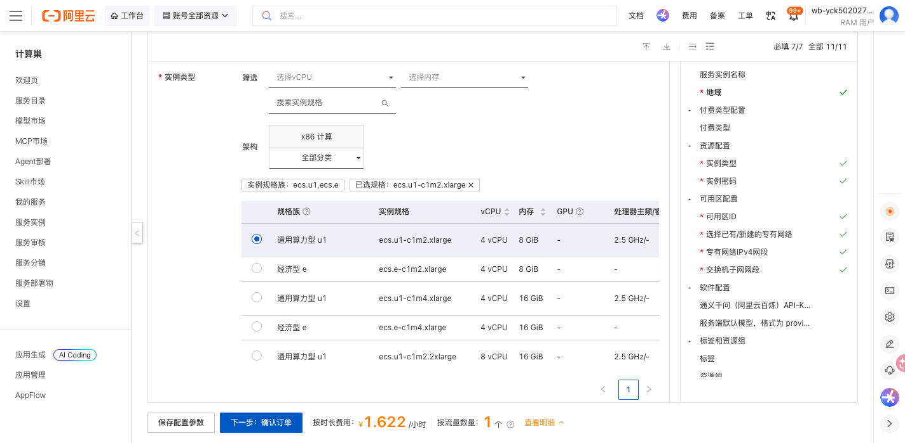
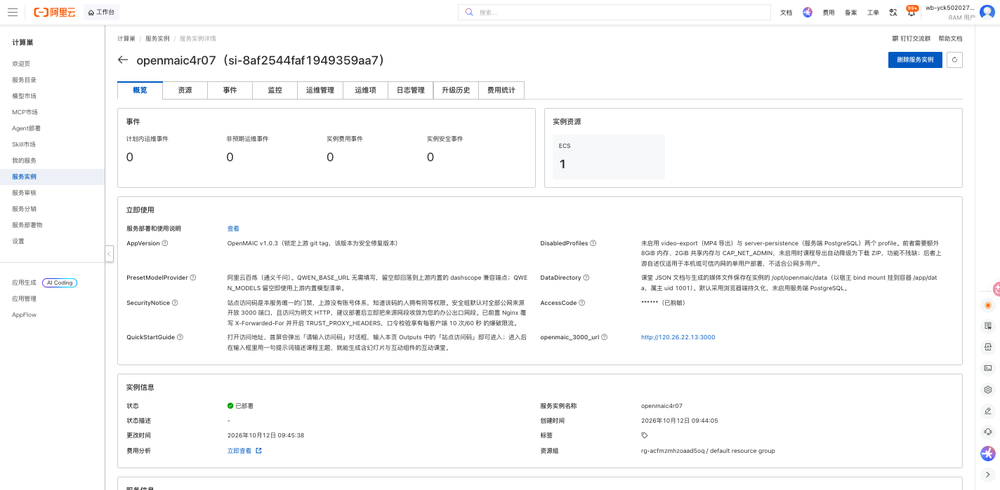
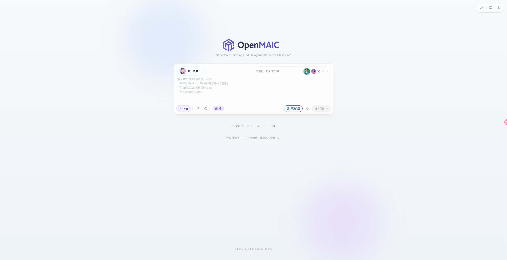

# OpenMAIC 部署文档

## 概述

[OpenMAIC](https://github.com/THU-MAIC/OpenMAIC) 是清华大学开源的多智能体互动课堂平台（MIT 协议）。输入一句提示词，即可生成包含幻灯片、互动组件和沉浸模式的完整课程，支持多智能体协作授课、课堂问答、白板讲解和课程导出，可接入通义千问等主流大模型。

本方案通过 Docker Compose 在一台云服务器 ECS 上部署 OpenMAIC v1.0.3，并前置 Nginx 反向代理，适合教学内容制作、课程体验和开发测试。

## 前提条件

部署 OpenMAIC 需要创建 ECS、VPC 和资源编排栈。使用 RAM 用户时，请确保已授予以下权限：

| 权限策略名称 | 说明 |
| --- | --- |
| AliyunECSFullAccess | 管理云服务器 ECS |
| AliyunVPCFullAccess | 管理专有网络 VPC |
| AliyunROSFullAccess | 管理资源编排 ROS |
| AliyunComputeNestUserFullAccess | 管理计算巢用户侧资源 |

如需使用通义千问模型，请提前在 [阿里云百炼](https://bailian.console.aliyun.com/) 开通服务并创建 API Key。

## 计费说明

部署费用主要来自 ECS 实例、200 GiB ESSD 系统盘和公网流量。模型调用费用由所选模型服务商单独收取。创建服务实例时，控制台会根据地域、可用区和实例规格显示预估费用，最终费用以实际账单为准。

## 部署架构

计算巢通过 ROS 创建 VPC、交换机、安全组和 ECS 实例，并通过云助手在 ECS 中以 Docker Compose 运行 OpenMAIC。外部请求经 Nginx 转发到 OpenMAIC 应用，对外端口为 3000。部署时会随机生成站点访问码，作为进入课堂平台的门禁。

## 部署流程

### 1. 创建服务实例

访问 [OpenMAIC 部署链接](https://computenest.console.aliyun.com/service/instance/create/cn-hangzhou?type=user&ServiceId=service-b49efe679e1746038091)，按页面提示填写部署参数。

主要参数如下：

| 参数 | 说明 |
| --- | --- |
| 服务实例名称 | 长度不超过 64 个字符，以英文字母开头 |
| 地域、可用区 | ECS 部署位置，建议选择离使用者较近的地域 |
| 付费类型 | 支持按量付费和包年包月 |
| 实例类型 | OpenMAIC 所在 ECS 的规格，可选 4 vCPU 8/16 GiB 或 8 vCPU 16 GiB |
| 实例密码 | ECS 登录密码，长度 8-30，需包含大写字母、小写字母、数字和特殊符号中的三项 |
| 专有网络 | 可新建专有网络，也可选择已有专有网络和交换机 |
| 通义千问 API-KEY | 可选。填写后服务端默认使用百炼模型；留空则部署后在页面设置中填写模型服务商 Key |
| 服务端默认模型 | 格式为 `provider:model`，默认 `qwen:qwen3.7-plus` |

### 2. 确认订单并创建

参数填写完成后，单击 **下一步：确认订单**。确认资源和费用，阅读并同意服务协议，然后单击 **立即创建**。

### 3. 等待部署完成

提交成功后进入服务实例列表。待实例状态变为 **已部署**，打开实例详情。实测部署约需 2 分钟。

### 4. 访问服务

在实例详情页的 **立即使用** 区域获取 `openmaic_3000_url` 访问地址和 `AccessCode` 站点访问码。打开地址后，在 **请输入访问码** 对话框中输入站点访问码，即可进入 OpenMAIC 首页。

## 使用说明

- 部署时未填写百炼 API Key 的，先单击输入框下方的 **配置模型**，填写模型服务商和 API Key。
- 在输入框中用一句话描述想学的内容，例如“用白板给我讲解傅里叶变换”，单击 **进入课堂** 即可生成互动课堂。
- 开启 **深度交互** 后，课堂会生成更多互动组件，例如 3D 演示、仿真、小游戏、思维导图和代码练习。
- 在 **最近学习** 中查看、搜索、导入课程，或新建文件夹整理课程。

本方案未启用上游的 MP4 视频导出与服务端 PostgreSQL 持久化，课程导出会自动采用 ZIP 格式，课程数据默认保存在浏览器端。

## 数据与安全

- 课堂 JSON 文档和生成的媒体文件保存在 ECS 的 `/opt/openmaic/data` 目录。删除服务实例会释放 ECS，请提前导出需要保留的课程。
- 站点访问码是唯一的访问门禁，知道该码的人拥有相同权限，请勿外传。
- 安全组默认对公网开放 3000 端口，且为 HTTP 访问。建议部署后将安全组来源网段收敛为办公出口网段，或自行配置 HTTPS。
- 请妥善保管 ECS 密码、模型 API Key 和站点访问码，避免在日志或公开仓库中泄露。

## 资源释放

不再使用时，在计算巢控制台删除服务实例，并确认关联的 ROS 栈、ECS、VPC 等资源均已释放，避免继续产生费用。

## 官方文档

- [OpenMAIC GitHub 仓库](https://github.com/THU-MAIC/OpenMAIC)
- [阿里云百炼 API Key 获取](https://bailian.console.aliyun.com/)
